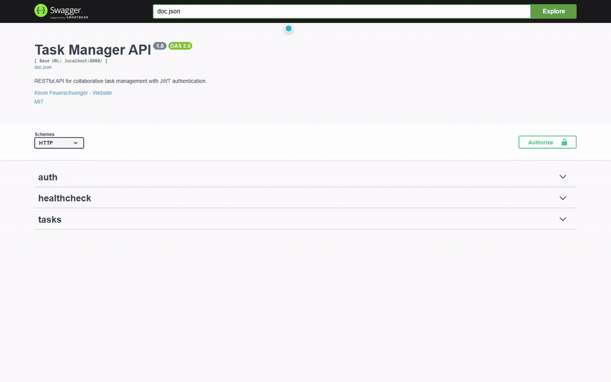
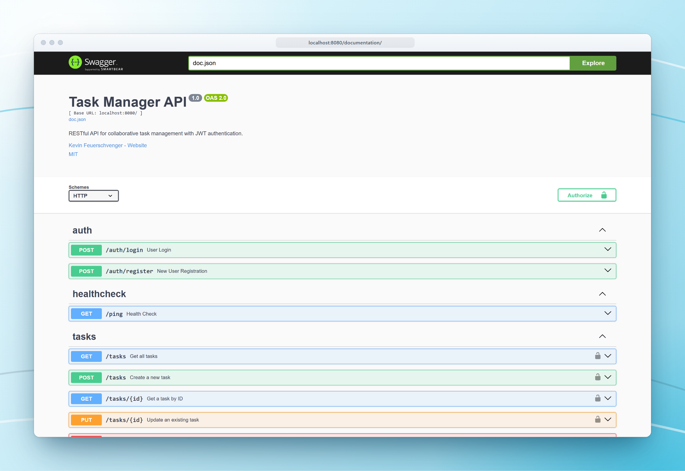
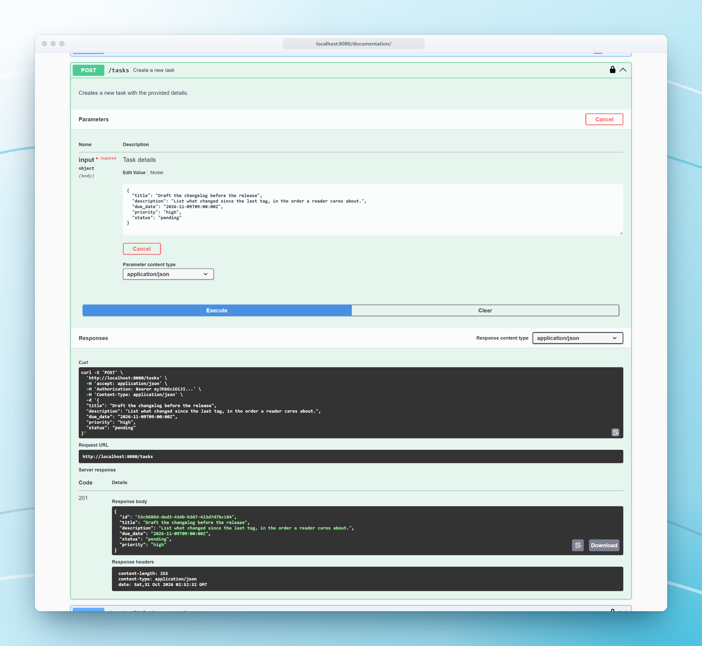
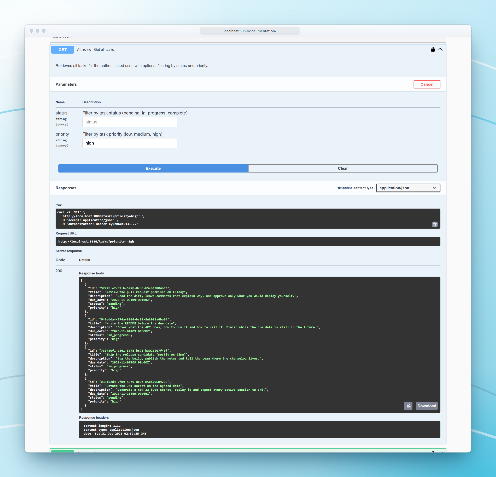
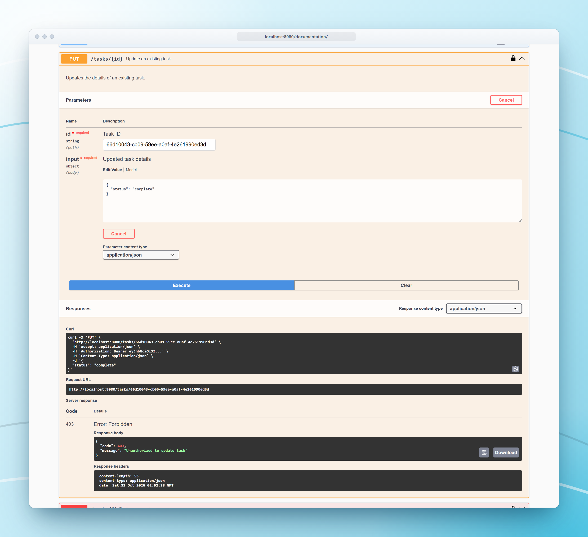
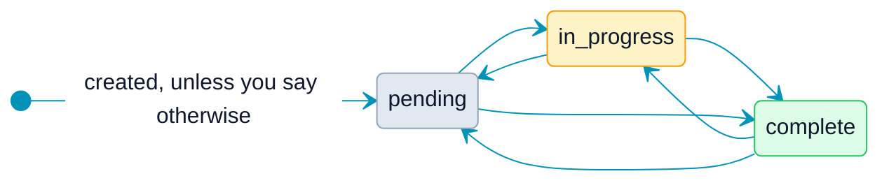
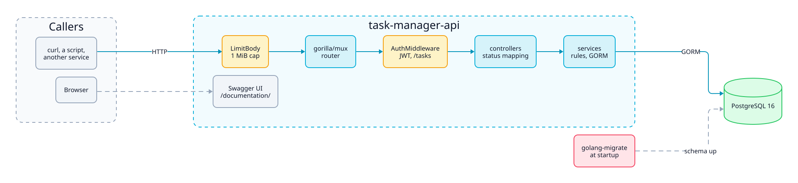

<p align="center">
  <picture>
    <source media="(prefers-color-scheme: dark)" srcset="docs/assets/brand/banner-dark.svg">
    
  </picture>
</p>

<p align="center">
  <a href="https://github.com/kfeuerschvenger/task-manager-api/actions/workflows/ci.yml"></a>
  <a href="LICENSE"></a>
  
  
  
</p>

<p align="center"><strong>English</strong> · <a href="README_es.md">Español</a></p>

<p align="center">
  
</p>

**Task Manager API is a Go REST API for tasks that have an owner, an assignee and a deadline that, with luck, someone meets.**

Register, sign in, and create tasks that move through `pending`, `in_progress` and `complete`. Give a task to a teammate and they can see it, while you keep the keys: only the creator edits or deletes.

It is a small, layered Go service on PostgreSQL, with JWT authentication, a Swagger UI generated from the code and a Docker setup that starts in three steps. The configuration is strict on purpose: a weak secret stops the server before it can make promises it cannot keep.

## Take the tour

<table>
  <tr>
    <td width="50%" valign="top">
      
      <p><strong>Every endpoint, one page.</strong> The Swagger UI is generated from the code, so what you read is what the server does.</p>
    </td>
    <td width="50%" valign="top">
      
      <p><strong>Tasks in, 201 out.</strong> Title, description and a due date are all it takes. Priority and status fall back to sensible defaults.</p>
    </td>
  </tr>
  <tr>
    <td width="50%" valign="top">
      
      <p><strong>Filter what is urgent.</strong> Ask for a status or a priority and get the tasks sorted by due date, soonest first.</p>
    </td>
    <td width="50%" valign="top">
      
      <p><strong>Looking is not editing.</strong> An assignee sees the task, but changing it is the creator's call, and the API says so with a 403.</p>
    </td>
  </tr>
</table>

## Endpoints at a glance

| Method | Path | Auth | Purpose |
|---|---|---|---|
| GET | `/ping` | None | Health check |
| POST | `/auth/register` | None | Create a user and get a token |
| POST | `/auth/login` | None | Sign in and get a token |
| GET | `/documentation/` | None | Swagger UI |
| GET | `/tasks` | Bearer | List your tasks, with `status` and `priority` filters |
| POST | `/tasks` | Bearer | Create a task |
| GET | `/tasks/{id}` | Bearer | Get one task |
| PUT | `/tasks/{id}` | Bearer | Update a task, creator only |
| DELETE | `/tasks/{id}` | Bearer | Delete a task, creator only |

Request fields, status codes and error bodies are in [docs/API.md](docs/API.md).

## What makes it special

- **The creator holds the keys.** Creator and assignee both see a task. Only the creator can update, reassign or delete it, and a user who is neither of them cannot even read it: they get a 404.
- **Assign it, keep it.** A creator can hand a task to a teammate and still own it, and still sees it in their list.
- **Deadlines are data.** Every task has a due date and the list is sorted by it. Past dates are accepted: the API records your optimism without judging it.
- **Strict by default.** `JWT_SECRET` must be at least 32 bytes, request bodies are capped at 1 MiB, passwords are hashed with bcrypt, and an unknown email gets the same answer as a wrong password.
- **Docs that cannot drift.** The Swagger spec is generated from the code, and CI fails when the committed spec is stale.

A task can move between statuses freely, and only its creator can move it: there is no gatekeeping between the three.



## Under the hood

<picture>
  <source media="(prefers-color-scheme: dark)" srcset="docs/assets/diagrams/architecture-dark.svg">
  
</picture>

One Go binary does it all. A request crosses the body limit and the `gorilla/mux` router, then the JWT middleware on the `/tasks` routes, and reaches a controller that decodes it and maps typed errors to status codes. The services hold the rules, including who may touch what, and talk to PostgreSQL through GORM. Migrations run with `golang-migrate` every time the server starts, and the Swagger UI is served by the same process.

<p align="center">
  &nbsp;
  &nbsp;
  
</p>

## Quick start

All you need is Docker, running.

```bash
cp .env.example .env
# edit .env: set JWT_SECRET to at least 32 bytes (openssl rand -base64 32)
docker compose up --build
```

Then open http://localhost:8080/documentation/ and try it out.

> [!TIP]
> Replace `JWT_SECRET` in `.env` with at least 32 bytes, for example the output of `openssl rand -base64 32`. The placeholder is rejected on purpose, so the server will not start with it. Every variable, running without Docker and the demo seed are in [ENVIRONMENT.md](docs/ENVIRONMENT.md).

## Dive deeper

The README is the elevator pitch. The deep docs are the building plans.

| Document | The hook |
|---|---|
| [Architecture](docs/ARCHITECTURE.md) | The layers, the startup sequence, how an error becomes a status code, the data model and the JWT design |
| [Environment](docs/ENVIRONMENT.md) | Every variable, Docker and local setup, the demo seed and what to check when the server refuses to start |
| [Testing](docs/TESTING.md) | Which packages need a database, two ways to run the suite and the pipeline that takes these screenshots |
| [CI](docs/CI.md) | The three jobs, branch protection and how Dependabot updates flow |
| [API](docs/API.md) | Every endpoint with its fields, status codes and error bodies, plus the Swagger workflow |
| [Roadmap](docs/ROADMAP.md) | What is still open, grouped by what it touches |

---

<p align="center">
  <strong>Made in Patagonia · 50°20′S</strong><br>
  Built with care by <strong>Kevin Feuerschvenger</strong> · Software Engineer (built before the due date, mostly)
</p>

<p align="center">
  <a href="https://github.com/kfeuerschvenger"></a>
  <a href="https://www.linkedin.com/in/kevin-feuerschvenger/"></a>
  <a href="https://feuerschvenger.com/"></a>
</p>

<p align="center"><sub>Released under the <a href="LICENSE">MIT licence</a>.</sub></p>
