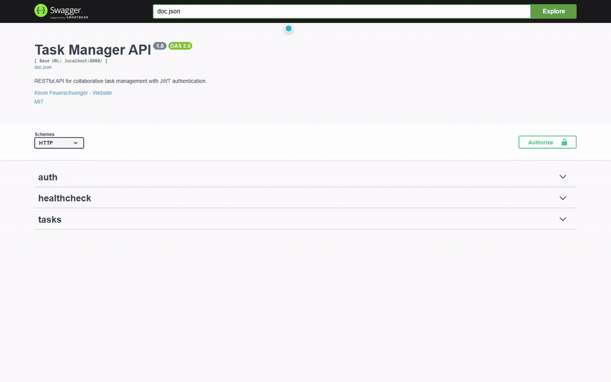
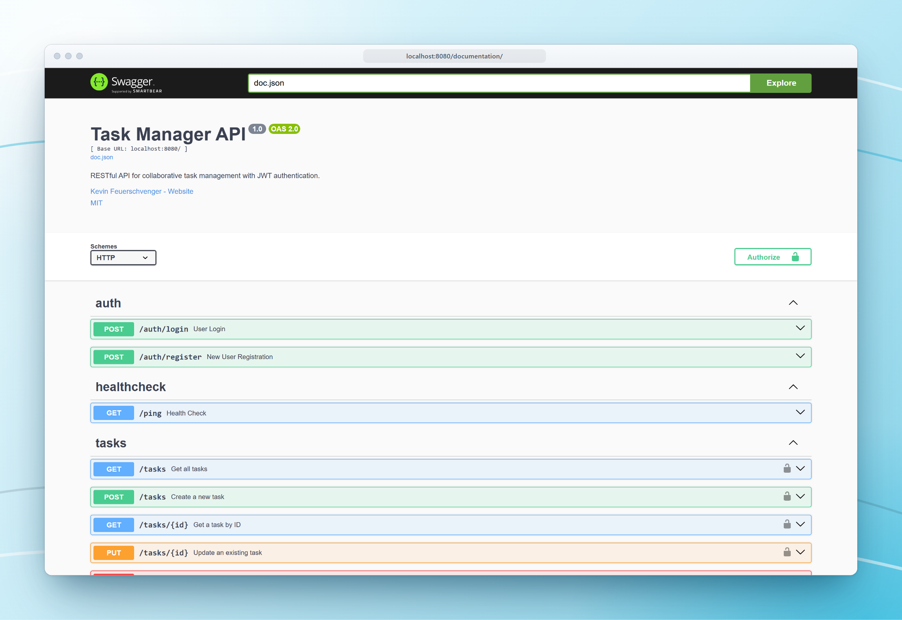
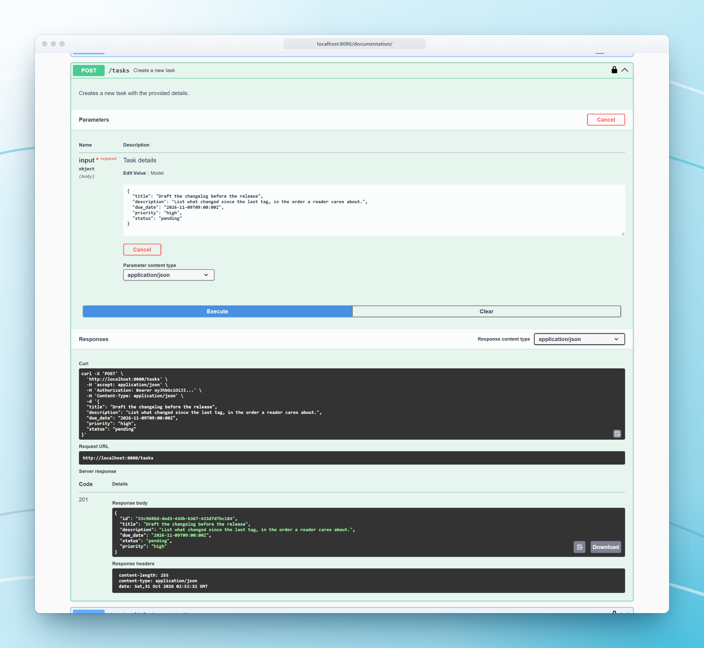
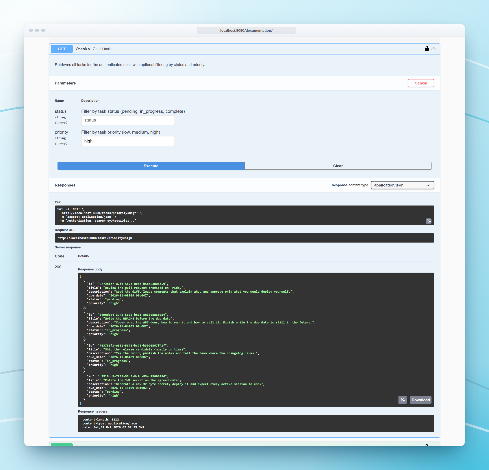
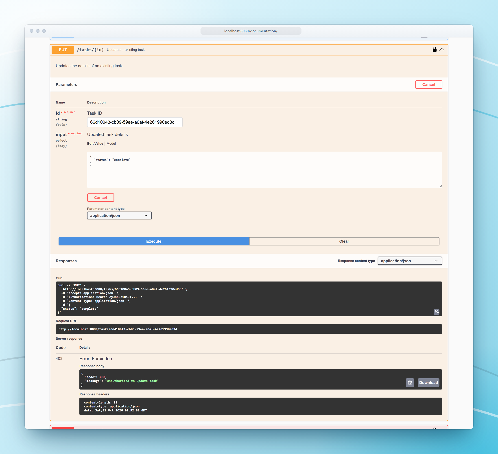
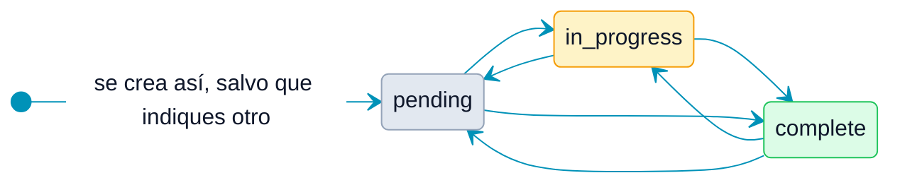
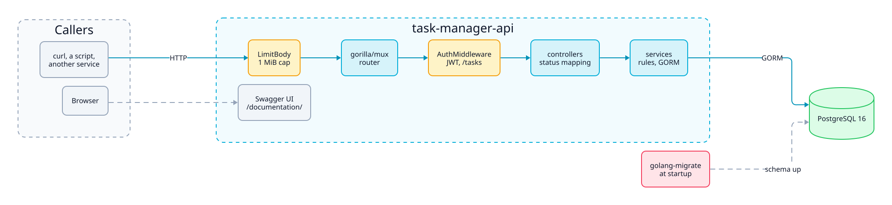

<p align="center">
  <picture>
    <source media="(prefers-color-scheme: dark)" srcset="docs/assets/brand/banner-dark.svg">
    
  </picture>
</p>

<p align="center">
  <a href="https://github.com/kfeuerschvenger/task-manager-api/actions/workflows/ci.yml"></a>
  <a href="LICENSE"></a>
  
  
  
</p>

<p align="center"><a href="README.md">English</a> · <strong>Español</strong></p>

<p align="center">
  
</p>

**Task Manager API es una API REST en Go para tareas que tienen un creador, un asignado y, con suerte, una fecha de vencimiento.**

Regístrate, inicia sesión y crea tareas que avanzan por `pending`, `in_progress` y `complete`. Si le asignas una tarea a un compañero, la puede ver, pero las llaves las conservas tú: solo el creador edita o elimina.

Es un servicio Go pequeño y por capas sobre PostgreSQL, con autenticación JWT, una interfaz Swagger generada desde el código y una configuración Docker que arranca con dos comandos. La configuración es estricta a propósito: un secreto débil detiene el servidor antes de que prometa lo que no puede cumplir.

## Un recorrido

<table>
  <tr>
    <td width="50%" valign="top">
      
      <p><strong>Todos los endpoints, una sola página.</strong> Swagger se genera desde el código, así que lo que lees es lo que hace el servidor.</p>
    </td>
    <td width="50%" valign="top">
      
      <p><strong>Tareas de entrada, 201 de salida.</strong> Con título, descripción y fecha de vencimiento alcanza. La prioridad y el estado toman valores por defecto razonables.</p>
    </td>
  </tr>
  <tr>
    <td width="50%" valign="top">
      
      <p><strong>Filtra lo urgente.</strong> Pide un estado o una prioridad y recibe las tareas ordenadas por vencimiento, las más próximas primero.</p>
    </td>
    <td width="50%" valign="top">
      
      <p><strong>Mirar no es editar.</strong> Un asignado ve la tarea, pero modificarla le corresponde al creador, y la API lo dice con un 403.</p>
    </td>
  </tr>
</table>

## Endpoints de un vistazo

| Método | Ruta | Autenticación | Propósito |
|---|---|---|---|
| GET | `/ping` | Ninguna | Chequeo de salud |
| POST | `/auth/register` | Ninguna | Crea un usuario y devuelve un token |
| POST | `/auth/login` | Ninguna | Inicia sesión y devuelve un token |
| GET | `/documentation/` | Ninguna | Interfaz Swagger |
| GET | `/tasks` | Bearer | Lista tus tareas, con filtros `status` y `priority` |
| POST | `/tasks` | Bearer | Crea una tarea |
| GET | `/tasks/{id}` | Bearer | Obtiene una tarea |
| PUT | `/tasks/{id}` | Bearer | Actualiza una tarea, solo el creador |
| DELETE | `/tasks/{id}` | Bearer | Elimina una tarea, solo el creador |

Los campos de cada petición, los códigos de estado y los cuerpos de error están en [docs/API.md](docs/API.md), que está en inglés.

## Qué la hace especial

- **El creador tiene las llaves.** Creador y asignado ven la tarea. Solo el creador puede actualizarla, reasignarla o eliminarla, y quien no es ninguno de los dos ni siquiera puede leerla: recibe un 404.
- **Asígnala y sigue siendo el dueño.** Un creador puede pasarle una tarea a un compañero y seguir siendo su dueño, y la sigue viendo en su lista.
- **Los vencimientos son datos.** Cada tarea tiene fecha de vencimiento y la lista se ordena por ella. Se aceptan fechas pasadas: la API registra tu optimismo sin juzgarlo.
- **Estricta por defecto.** `JWT_SECRET` debe tener al menos 32 bytes, los cuerpos de las peticiones están limitados a 1 MiB, las contraseñas se guardan con bcrypt y un correo desconocido recibe la misma respuesta que una contraseña incorrecta.
- **Documentación que no se desfasa.** La especificación Swagger se genera desde el código, y CI falla cuando la versión guardada está desactualizada.

Una tarea puede pasar de un estado a cualquier otro, y solo su creador puede moverla: no hay controles entre los tres.



## Bajo el capó

<picture>
  <source media="(prefers-color-scheme: dark)" srcset="docs/assets/diagrams/architecture-dark.svg">
  
</picture>

Un único binario de Go hace todo. Una petición cruza el límite de cuerpo y el router `gorilla/mux`, después el middleware JWT en las rutas `/tasks`, y llega a un controlador que la decodifica y traduce los errores tipados a códigos de estado. Los servicios contienen las reglas, incluida la de quién puede tocar qué, y hablan con PostgreSQL mediante GORM. Las migraciones corren con `golang-migrate` cada vez que arranca el servidor, y la interfaz Swagger la sirve el mismo proceso.

<p align="center">
  &nbsp;
  &nbsp;
  
</p>

## Inicio rápido

Solo necesitas Docker en ejecución.

```bash
cp .env.example .env
docker compose up --build
```

Después abre http://localhost:8080/documentation/ y pruébala.

> [!TIP]
> Reemplaza `JWT_SECRET` en `.env` por al menos 32 bytes, por ejemplo la salida de `openssl rand -base64 32`. El valor de ejemplo se rechaza a propósito, así que el servidor no arranca con él. Todas las variables, cómo correrlo sin Docker y los datos de demostración están en [ENVIRONMENT.md](docs/ENVIRONMENT.md).

## Para profundizar

El README es la presentación rápida. Los documentos de fondo son los planos. Están en inglés.

| Documento | De qué trata |
|---|---|
| [Architecture](docs/ARCHITECTURE.md) | Las capas, la secuencia de arranque, cómo un error se vuelve un código de estado, el modelo de datos y el diseño del JWT |
| [Environment](docs/ENVIRONMENT.md) | Cada variable, la configuración con Docker y local, los datos de demostración y qué revisar cuando el servidor se niega a arrancar |
| [Testing](docs/TESTING.md) | Qué paquetes necesitan base de datos, dos formas de correr las pruebas y el proceso que toma estas capturas |
| [CI](docs/CI.md) | Los tres jobs, la protección de ramas y cómo fluyen las actualizaciones de Dependabot |
| [API](docs/API.md) | Cada endpoint con sus campos, códigos de estado y cuerpos de error, más el flujo de Swagger |
| [Roadmap](docs/ROADMAP.md) | Lo que sigue abierto, agrupado por lo que toca |

---

<p align="center">
  <strong>Hecho en la Patagonia · 50°20′S</strong><br>
  Hecho con cariño por <strong>Kevin Feuerschvenger</strong> · Ingeniero de Software (terminado antes del vencimiento, casi siempre)
</p>

<p align="center">
  <a href="https://github.com/kfeuerschvenger"></a>
  <a href="https://www.linkedin.com/in/kevin-feuerschvenger/"></a>
  <a href="https://feuerschvenger.com/"></a>
</p>

<p align="center"><sub>Publicado bajo la <a href="LICENSE">licencia MIT</a>.</sub></p>
