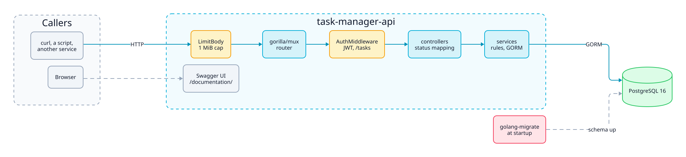
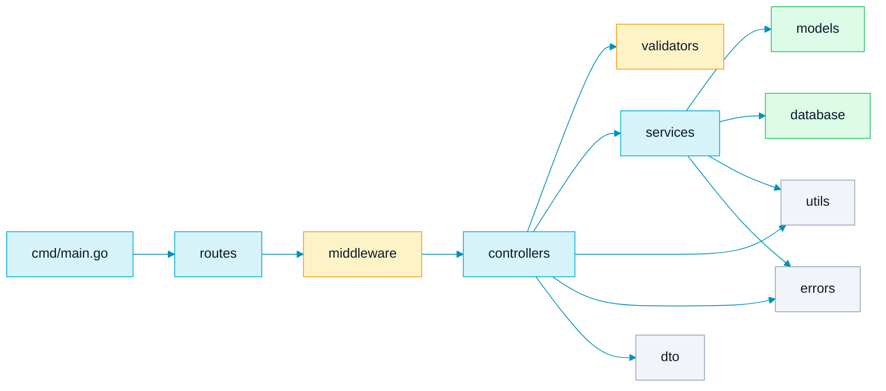
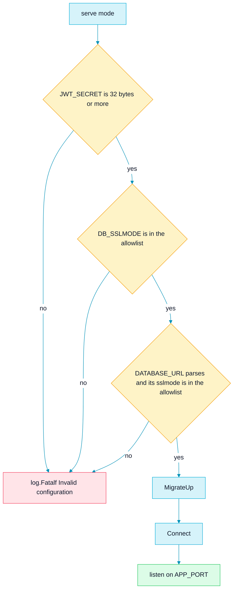
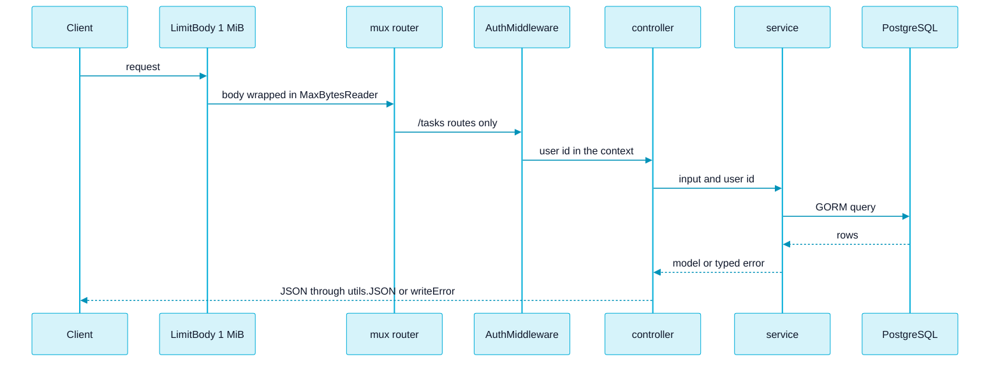
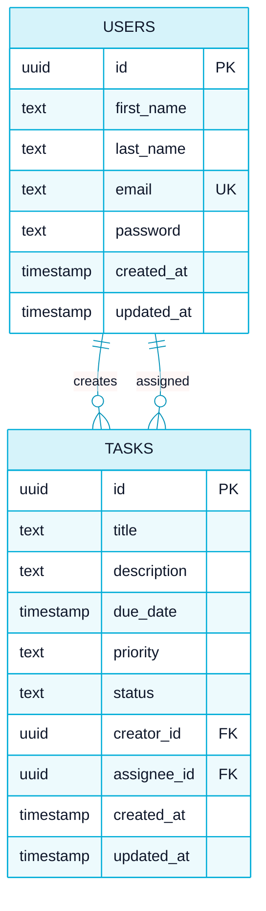

<picture>
  <source media="(prefers-color-scheme: dark)" srcset="assets/brand/header-strip-dark.svg">
  
</picture>

# Architecture

A small Go service with firm layers: a request crosses the same few packages every time, and each package has one job.

This page covers the layers, the startup sequence, how a typed error becomes a status code, the data model, the JWT and password design, and the task rules. The variables live in [ENVIRONMENT.md](ENVIRONMENT.md), the tests in [TESTING.md](TESTING.md) and the HTTP contract in [API.md](API.md).

## System

<picture>
  <source media="(prefers-color-scheme: dark)" srcset="assets/diagrams/architecture-dark.svg">
  
</picture>

One binary does everything: it applies the migrations, connects to PostgreSQL, serves the JSON API and hosts the Swagger UI. The diagram source is [assets/diagrams/architecture.d2](assets/diagrams/architecture.d2), with a dark variant next to it.

## Layers

| Package | Role | Notes |
|---|---|---|
| `cmd` | Parses the mode, validates configuration, runs migrations, connects, serves | Modes: `serve` (default), `migrate [up\|down]` and `seed`. Any other mode prints the usage and exits with 1 |
| `routes` | `SetupRoutes()` returns a `*mux.Router` | Public routes, the Swagger UI and the protected `/tasks` subrouter |
| `middleware` | `AuthMiddleware` and `LimitBody` | `UserIDKey` is the context key that carries the user id |
| `controllers` | Decode, validate the shape, call a service, map the result | `writeError` and `writeDecodeError` live in `controllers/errors.go` |
| `services` | Business rules and GORM queries | They use the package level `database.DB`. There are no interfaces and no repository layer |
| `dto` | The JSON contracts | Struct tags carry the Swagger `example`, `enums` and `format`. The `validate:"required"` tags are documentation: no validator library runs them |
| `models` | GORM structs `User` and `Task` | `User.BeforeCreate` assigns a UUID. The service sets the task id |
| `validators` | Register and login input checks | They return a `*errors.ValidationError` |
| `errors` | Typed application errors | Imported as `apperrors` in the controllers |
| `utils` | JWT, bcrypt, email normalisation and the JSON response helpers | `utils` imports `dto` and `errors`, so those two must never import `utils` |
| `database` | Connection, DSN and URL builders, sslmode validation and the migration runner | Holds the global `DB *gorm.DB` and `migrations/*.sql` |

The Swagger general information (title, contact, host, the `BearerAuth` security definition) is annotated at the top of `cmd/main.go`. The generated spec is committed in `docs/`: `docs.go`, `swagger.json` and `swagger.yaml`.

## Startup sequence

In `serve` mode the process refuses to start on a bad configuration instead of failing later under load.

1. `godotenv.Load()` reads `.env` when it exists. A missing file only logs a line.
2. `validateStartupConfig()` runs the three checks above. Any failure is fatal.
3. `database.MigrateUp()` applies pending migrations. They always run on startup.
4. `database.Connect()` opens GORM with a DSN built from the `DB_*` variables.
5. `startServer()` builds the router, wraps it with `LimitBody` and listens on `APP_PORT` (default `8080`).

`migrate [up|down]` skips the configuration validation and the connection: it only runs the migrations. `seed` loads the demo data and is documented in [ENVIRONMENT.md](ENVIRONMENT.md#demo-seed).

## Request flow

- `LimitBody` wraps the whole router, so the 1 MiB cap applies to every route and not only to `/tasks`.
- `AuthMiddleware` requires `Authorization: Bearer <token>`, and the prefix check is case sensitive. A missing prefix gives 401 `Missing or invalid token`. A token that fails verification gives 401 `Invalid token`.
- Controllers read the user id from the request context with a type assertion that is safe only behind `AuthMiddleware`.
- Every error body is a `dto.ErrorResponse`: `{"code": <status>, "message": "<text>"}`.

## Typed errors become status codes

`controllers.writeError(w, err, internalMsg)` classifies the error with `errors.As`, in this order. Controllers never compare error strings.

| Error type | Built by | Status | Message sent |
|---|---|---|---|
| `*ValidationError` | `NewValidationError`, `ErrInvalidID(entity)`, `ErrInvalidField(field)` | 400 | Its message, first letter capitalised |
| `*NotFoundError` | `ErrNotFound(entity)` | 404 | `<Entity> not found` |
| `*ForbiddenError` | `ErrUnauthorizedAction(action, entity)` | 403 | `Unauthorized to <action> <entity>` |
| `*ConflictError` | `NewConflictError` | 409 | Its message |
| `*AuthError` | `NewAuthError` | 401 | Its message |
| Anything else, including `*InternalServerError` | `NewInternalServerError`, `WrapInternalServerError` | 500 | The fixed message of the call site. The real error goes to the log |

- The register and login validators bypass `writeError`: the controller sends the validator message as written, in lowercase (for example `invalid email format`).
- `writeDecodeError` answers 413 `Request body too large` for a `*http.MaxBytesError` and 400 with the call site message for any other decode failure.
- `GetTasks` is the one handler that bypasses `writeError`: any service error becomes 500 `Failed to retrieve tasks`.
- The message and cause of an `InternalServerError` are for the log only and are never written to a response.

## Data model

- `priority` is checked against `low`, `medium`, `high` (default `medium`). `status` is checked against `pending`, `in_progress`, `complete` (default `pending`).
- Both foreign keys use `ON DELETE CASCADE`. No endpoint deletes a user.
- Indexes: `idx_tasks_status` and `idx_tasks_priority`. There is none on `creator_id` or `assignee_id`.
- Timestamps are `TIMESTAMP` without a time zone, and the GORM DSN sets `TimeZone=UTC`.
- Emails are stored trimmed and lowercased, and `email` is `UNIQUE`.
- `due_date` is not compared with the present, so past dates are accepted.

### Migrations

Files in `database/migrations/`, applied by `golang-migrate` through the `file://` source.

| Version | Up | Down |
|---|---|---|
| 000001 | `CREATE EXTENSION IF NOT EXISTS "uuid-ossp"` | `DROP EXTENSION IF EXISTS "uuid-ossp"` |
| 000002 | The `users` table | `DROP TABLE IF EXISTS users` |
| 000003 | The `tasks` table, its checks, foreign keys and two indexes | Drops the indexes, then `tasks` |

- The source path is `MIGRATIONS_PATH`, which defaults to `file://database/migrations` (relative to the working directory).
- The database URL is `DATABASE_URL` when set, otherwise it is built from `DB_*` with every component escaped. An empty `DB_HOST`, `DB_PORT`, `DB_USER` or `DB_NAME` fails with `database connection variables are not set`. The password may be empty.
- `migrate.ErrNoChange` counts as success.
- Do not mount `database/migrations` into `docker-entrypoint-initdb.d`: PostgreSQL would run the `.down.sql` files as well. Migrations run from the application only.
- The migration runner uses `lib/pq` and GORM uses pgx: two drivers and two connections from one configuration. That is why the sslmode allowlist is the intersection of what both accept, see [ENVIRONMENT.md](ENVIRONMENT.md#startup-validation).

## JWT design

- Implemented in `utils/jwt.go`. HS256 only (`jwt.WithValidMethods`). The claims are `user_id` and `exp`, which is 72 hours after issue. There is no refresh and no revocation.
- `JWT_SECRET` is read when a token is signed or verified, never in a package level variable. A package level read would run before `godotenv.Load()` and sign with an empty key.
- `ValidateJWTSecret()` runs at startup: an empty secret fails, and so does one shorter than 32 bytes.
- Register (201) and login (200) both return `{"token": "..."}`, so registering also signs the user in.
- `VerifyJWT` returns the `user_id`, or an error the middleware reports as 401 `Invalid token`.

## Passwords

- Registration requires at least 8 characters, counted in runes, and at most 72 bytes. The limit is the bcrypt input size. The two units differ on purpose: a password of 20 emoji is under 72 characters and far over 72 bytes, so it is refused.
- Login only requires a non-empty password. Hashing uses `bcrypt.DefaultCost` (10).
- Names need at least 2 bytes after trimming. The email must parse with `net/mail` after normalisation.
- An unknown email at login still runs a bcrypt comparison against a precomputed dummy hash, so the response takes about as long as a wrong password for a real user. Both cases answer the same 401 `Invalid credentials`.
- Register answers 409 `Email already registered` for a known email, so account existence can be probed through registration.

## Task rules

The rules live in `services/task_service.go`.

- The creator or the assignee can read a task. A task the caller neither created nor received answers 404 on read, never 403, so its existence is not confirmed.
- Only the creator can update or delete. Update and delete look the task up by id only, so an id that does not exist is 404 and one owned by someone else is 403.
- Update accepts `status`, `priority`, `due_date`, `description` and `assignee_id`. There is no `title` in `UpdateTaskDTO`, so a title cannot change after creation. An empty string means "leave unchanged", so a field cannot be cleared.
- Status changes are free: any status can move to any other, there is no transition table. See [the lifecycle in the README](../README.md#what-makes-it-special).
- Priority and status are validated in the service before the database check would refuse them.
- `assignee_id` must belong to an existing user, otherwise 400 `Assignee does not exist`.
- The list orders by `due_date` ascending and supports exact-match `status` and `priority` filters. An unknown filter value returns an empty list, not 400.
- Update and delete read and then write without a transaction, so concurrent edits are last write wins.

## Limits and timeouts

| Setting | Value | Where |
|---|---|---|
| Body cap | 1 MiB | `maxBodyBytes` in `cmd/main.go`, applied by `middleware.LimitBody` around the whole router |
| `ReadHeaderTimeout` | 5 s | `http.Server` in `startServer` |
| `ReadTimeout` | 10 s | Same |
| `WriteTimeout` | 15 s | Same |
| `IdleTimeout` | 60 s | Same |
| Shutdown drain | 10 s | SIGINT or SIGTERM calls `srv.Shutdown` with a 10 s context |

`ListenAndServe` returns as soon as `Shutdown` starts, and `main` returns with it, so the process does not wait for the drain to finish. Making it wait is on the [roadmap](ROADMAP.md#reliability).

The 15 s `WriteTimeout` also bounds a bcrypt hash plus the database round trips: services have no per-request context timeout.

---

[Back to the README](../README.md) · Next: [Environment](ENVIRONMENT.md)
