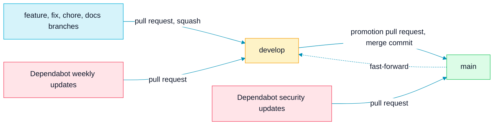

<picture>
  <source media="(prefers-color-scheme: dark)" srcset="assets/brand/header-strip-dark.svg">
  
</picture>

# CI

Three jobs stand between a branch and `main`: lint, test and docker. Nothing is due before they are green.

## Branch flow

Work happens on short branches. `develop` and `main` are both protected: they take changes only through pull requests, with the three required checks green and the branch up to date.

1. Feature branches are squash-merged into `develop`.
2. A promotion pull request from `develop` into `main` uses a merge commit, so both branches keep the same commits.
3. After the promotion, `develop` is fast-forwarded to `main` so the next promotion is not behind.

## The workflow

`.github/workflows/ci.yml` is named `CI`, and its badge in the README follows `main`.

| Setting | Value |
|---|---|
| Triggers | Pushes to `main` and `develop`, and pull requests into them |
| Permissions | Read-only `contents` |
| Concurrency | One run per workflow and ref. A newer push to a pull request cancels the run in progress, while a push to a protected branch always runs to the end |
| Toolchain | `actions/setup-go` with `go-version-file: go.mod`, so CI uses the same Go as the module (1.25) |

## Jobs

The job names are what branch protection requires, so renaming one detaches it from the rule.

| Job | Timeout | Runs |
|---|---|---|
| `lint` | 10 min | `gofmt -l .` (any unformatted file fails the job), `go vet ./...`, and a freshness check of the Swagger docs: it regenerates them with `swag` v1.16.6 and fails when `docs/` differs from what is committed |
| `test` | 15 min | `go test ./... -count=1 -race` against a `postgres:16-alpine` service container with a health check. The job sets `DB_*`, a test-only `JWT_SECRET` and an absolute `MIGRATIONS_PATH` |
| `docker` | 15 min | `docker build` of the runtime image. It is built and thrown away: nothing is pushed |

> [!TIP]
> To reproduce CI before you push, run `gofmt -l .`, `go vet ./...`, the Swagger command from [API.md](API.md#regenerating-the-spec) followed by `git status docs/`, the suite from [TESTING.md](TESTING.md) and `docker build .`.

## Branch protection

`main` and `develop` have the same rules.

| Rule | Setting |
|---|---|
| Required checks | `lint`, `test` and `docker`, with the branch up to date before merging |
| Pull requests | Required, with zero approvals needed |
| Administrators | The rules apply to them too |
| Conversations | Every review conversation must be resolved |
| Force pushes and deletions | Blocked |

## Dependabot

`.github/dependabot.yml` covers three ecosystems: Go modules, GitHub Actions and the Docker base images.

- Version updates run weekly, and minor and patch updates are grouped into one pull request per ecosystem. They target `develop`, so they flow through the normal promotion.
- Security updates are not part of that schedule. They are opened against `main`, the default branch, so a fix for a vulnerable dependency does not wait for the next promotion. `develop` is fast-forwarded from `main` afterwards.
- GitHub secret scanning and push protection are enabled on the repository.

---

[Back to the README](../README.md) · Previous: [Testing](TESTING.md) · Next: [API](API.md)
