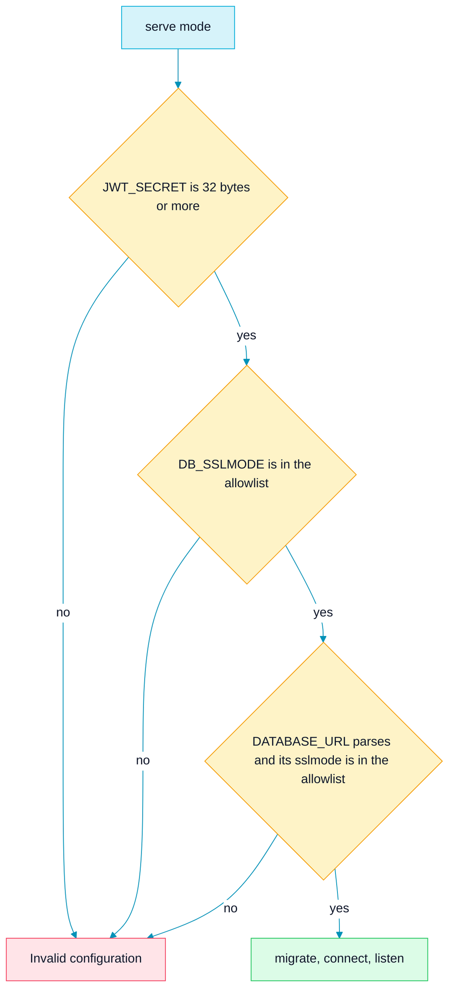
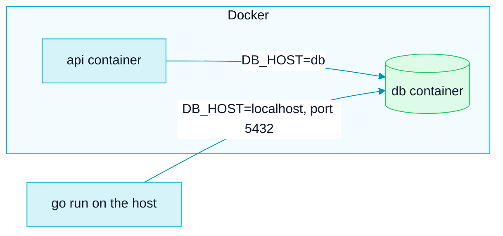

<picture>
  <source media="(prefers-color-scheme: dark)" srcset="assets/brand/header-strip-dark.svg">
  
</picture>

# Environment

Every variable the service reads, how to run it in Docker or on your machine, and what to check when it refuses to start.

The toolchain is Go 1.25 (`go 1.25.0` in `go.mod`, `golang:1.25.14-alpine` in the images) and PostgreSQL 16. The service reads its configuration with `os.Getenv` in `cmd/main.go`, `database/` and `utils/jwt.go`, and `.env.example` is the committed template.

## Quick path

```bash
cp .env.example .env
docker compose up --build
```

Then open http://localhost:8080/documentation/.

> [!IMPORTANT]
> `.env.example` ships `JWT_SECRET=change-me` on purpose. It is 9 bytes, so the server refuses to start until you replace it with at least 32 bytes, for example the output of `openssl rand -base64 32`. Replace `DB_PASSWORD` as well before you use the database for anything real.

## Variables

| Variable | Default | Validation | Used by |
|---|---|---|---|
| `DB_HOST` | none | None at startup. An empty value fails later, as a migration configuration error or a connection error. Brackets around an IPv6 literal are stripped | Migrations URL and GORM DSN |
| `DB_PORT` | none | None at startup | Same |
| `DB_USER` | none | None at startup | Same |
| `DB_PASSWORD` | none, may be empty | None. Escaped in both the URL and the DSN | Same |
| `DB_NAME` | none | None at startup | Same |
| `DB_SSLMODE` | `disable` | Must be one of `disable`, `require`, `verify-ca`, `verify-full`. Anything else is fatal | Migrations URL and GORM DSN |
| `DB_SSLROOTCERT` | empty | None. When set it is added as `sslrootcert`. Empty lets libpq look in its default location | Same |
| `DATABASE_URL` | empty | When set it must parse, and any `sslmode` it carries must be in the allowlist | Migrations only, see [below](#database_url) |
| `JWT_SECRET` | none | Required, at least 32 bytes. The server refuses to start otherwise | Signing and verifying tokens, read at call time |
| `APP_PORT` | `8080` | None. Used as `":" + APP_PORT` | The listen address, the compose port mapping and the image healthcheck |
| `MIGRATIONS_PATH` | `file://database/migrations` | None | `MigrateUp` and `MigrateDown` |
| `APP_ENV` | none | The `seed` mode only runs when it is `development`, `dev`, `local` or `test`, trimmed and case-insensitive | `seed` mode |
| `DEMO_PASSWORD` | none | Required by `seed`, and it must meet the password policy (8 characters or more, at most 72 bytes) | `seed` mode |
| `DEMO_REFERENCE` | `2026-11-02` | A `YYYY-MM-DD` date that the demo due dates are measured from | `seed` mode |
| `DEMO_SEED_ALLOW_REMOTE` | unset | `1` lets the seed run against a database host that is not local | `seed` mode |

`DB_SSLROOTCERT` and the `seed` variables are not listed in `.env.example`: the first is optional and the others belong to a command you run by hand.

## Startup validation

`serve` mode runs three checks before it touches the database, and any failure ends the process with `Invalid configuration`.



**Why the sslmode allowlist excludes `allow` and `prefer`.** PostgreSQL defines both, but migrations run through `golang-migrate` with the `lib/pq` driver, which rejects them, while the GORM pgx driver would accept them. The allowlist is the intersection, so one configuration works for both connections and a value that would only fail halfway through startup is caught first.

`migrate up|down` does not run this validation. The sslmode check still happens while the URL is built from `DB_*`, which is only when `DATABASE_URL` is unset.

### DATABASE_URL

- When it is set, it replaces the `DB_*` variables for migrations only. The application connection always builds its DSN from `DB_*`, so a deployment that sets only `DATABASE_URL` migrates fine and then fails to connect.
- `DB_SSLMODE` and `DB_SSLROOTCERT` are not merged into it. Put `sslmode` and `sslrootcert` in the URL itself.
- `DB_SSLMODE` is still validated at startup even when `DATABASE_URL` is set.
- An unparsable value is reported by the URL parser, which includes the value in its message. Check it for typos, for example a password with an unescaped `%`, before you share a log.

### TLS to the database

- `require`, `verify-ca` and `verify-full` enable TLS. The runtime image ships `ca-certificates`, so servers signed by a public CA work with no extra setup.
- For a private CA, mount the root certificate into the container and point `DB_SSLROOTCERT` at the path inside it. A compose override on the `api` service does it:

```yaml
services:
  api:
    volumes:
      - ./certs/root.crt:/certs/root.crt:ro
```

and in `.env`:

```bash
DB_SSLMODE=verify-full
DB_SSLROOTCERT=/certs/root.crt
```

DSN values are single-quoted with backslash escaping. `TimeZone=UTC` is appended unquoted on purpose, because pgx keeps the quotes of runtime parameters as part of the value.

## Docker and compose

| Item | Value |
|---|---|
| Image build | Multi-stage. The builder is `golang:1.25.14-alpine` and runs `CGO_ENABLED=0 go build -o main ./cmd/main.go`. The runtime is `alpine:3.21` |
| Runtime user | A non-root system user `app` |
| Copied into the image | The binary, `docs/` and `database/migrations/`. Never `.env` |
| Image environment | `MIGRATIONS_PATH=file:///app/database/migrations` |
| `EXPOSE` | `8080`, fixed. It is informational: the real port follows `APP_PORT` |
| Image healthcheck | `wget -qO- http://127.0.0.1:${APP_PORT:-8080}/ping` every 30 s, timeout 5 s, start period 20 s, 3 retries |
| `docker-compose.yml` services | `api` (builds the Dockerfile, `restart: unless-stopped`, `env_file: .env`, waits for `db` to be healthy) and `db` (`postgres:16-alpine`) |
| API port mapping | `${APP_PORT:-8080}:${APP_PORT:-8080}` on all interfaces |
| PostgreSQL port | `127.0.0.1:5432:5432`, local only |
| PostgreSQL setup | `POSTGRES_DB`, `POSTGRES_USER` and `POSTGRES_PASSWORD` come from `DB_NAME`, `DB_USER` and `DB_PASSWORD`. Data volume `postgres_data`, with `--data-checksums`, UTF-8 and `C` collation |
| PostgreSQL healthcheck | `pg_isready -U ${DB_USER}` every 5 s, timeout 5 s, 5 retries |

Compose does not set `DB_HOST` for the API: it comes from `.env`, and inside compose it must be `db`.

## Running



### In Docker

```bash
cp .env.example .env
# edit .env: set JWT_SECRET (32 bytes or more) and DB_PASSWORD
docker compose up --build
```

Migrations run on startup. The Swagger UI is at http://localhost:8080/documentation/ and the health check is `GET /ping`.

### Locally

Run the API on your machine and keep PostgreSQL in Docker. Publish the database with `docker compose up -d db`, set `DB_HOST=localhost` in `.env` (godotenv loads `.env` from the working directory), leave `MIGRATIONS_PATH` unset and run from the repository root:

```bash
go run ./cmd/main.go
```

To run migrations alone, use `go run ./cmd/main.go migrate up` or `migrate down`. Down reverts every migration: there is no step count.

## Demo seed

The `seed` mode loads a deterministic demo: two users and ten tasks written in the project voice. It is what the screenshots in the README are taken from. It applies the migrations first, so it works on an empty database.

```bash
APP_ENV=development DEMO_PASSWORD=<password> go run ./cmd seed
```

In Docker, against the compose stack:

```bash
docker compose exec -e APP_ENV=development -e DEMO_PASSWORD=<password> api ./main seed
```

On success it prints the two demo emails, `maya.rivera@example.com` (the creator) and `theo.nakamura@example.com` (the assignee), and both sign in with the password you chose.

| Guard | Behaviour |
|---|---|
| `APP_ENV` | An allowlist: only `development`, `dev`, `local` or `test` run the seed. An unset or unknown value, `production` included, is refused |
| `DEMO_PASSWORD` | No default. A missing password, or one that breaks the password policy, is refused before any database is opened |
| Database host | Every target is logged with its role, without credentials. The seed refuses unless all of them are local: `localhost`, `127.0.0.1`, `::1`, `db` or `host.docker.internal`. The migration target is the host of `DATABASE_URL` when it is set, otherwise `DB_HOST`. The connection target is always `DB_HOST`. A `DATABASE_URL` whose query carries `host`, `hostaddr` or `service` is refused, because those override the host. Set `DEMO_SEED_ALLOW_REMOTE=1` to seed another host on purpose |
| Idempotence | A second run leaves the same rows. It replaces the tasks created by the two demo users with the same set, and leaves everyone else untouched. It aborts without writing if a user already holds a demo email under a different id |
| `DEMO_REFERENCE` | The due dates are measured from a fixed date, so the data does not drift with the day you seed. Set a `YYYY-MM-DD` value to measure from another day. An invalid value is rejected before the database is opened |

The capture pipeline that photographs the seeded demo is described in [TESTING.md](TESTING.md#the-capture-pipeline).

## Troubleshooting

| Symptom | Check |
|---|---|
| `Invalid configuration: JWT_SECRET must be at least 32 bytes long` | Replace the `change-me` placeholder, for example with `openssl rand -base64 32` |
| `invalid DB_SSLMODE` | Use `disable`, `require`, `verify-ca` or `verify-full`. `allow` and `prefer` are not accepted |
| `database connection variables are not set` | `DB_HOST`, `DB_PORT`, `DB_USER` or `DB_NAME` is empty, or the `.env` file is not being loaded from the working directory |
| The API starts, migrates and then cannot connect | You set only `DATABASE_URL`. The connection uses `DB_*`: set them too |
| Connection refused to `db` when running with `go run` | Inside compose the host is `db`, on your machine it is `localhost`. The same `.env` cannot serve both without editing |
| The migrations cannot be found | `MIGRATIONS_PATH` defaults to a path relative to the working directory, so run from the repository root. Go tests run from the package directory and need `file://../database/migrations`, which the `tests` package sets by itself when the variable is unset. The image uses an absolute path |
| `seed refused` | Read the message: it names the guard, `APP_ENV`, the password or the database host |

> [!NOTE]
> On Windows with Git Bash, an argument that is a bare absolute path, such as `-e DB_SSLROOTCERT=/certs/root.crt` or a volume path, is rewritten into a Windows path. Prefix the command with `MSYS_NO_PATHCONV=1`. PowerShell does not need it.

Changing `APP_PORT` at runtime works for the listener, the compose mapping and the healthcheck, but not for `EXPOSE`, which stays informational.

---

[Back to the README](../README.md) · Previous: [Architecture](ARCHITECTURE.md) · Next: [Testing](TESTING.md)
