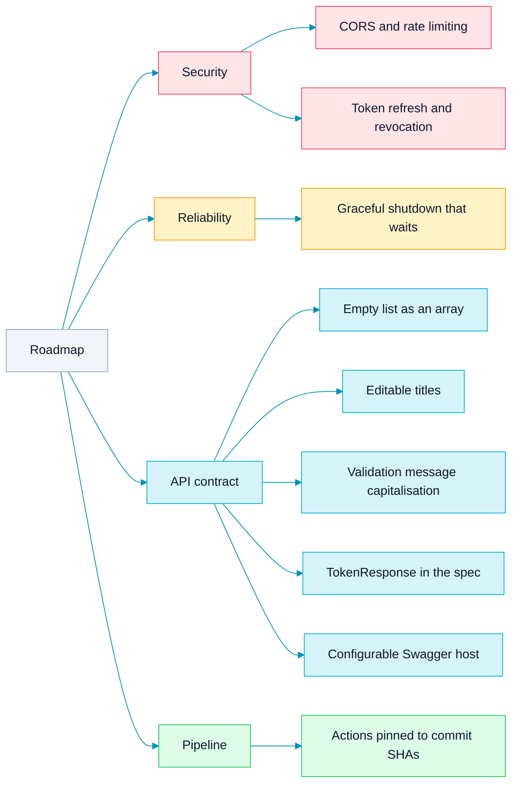

<picture>
  <source media="(prefers-color-scheme: dark)" srcset="assets/brand/header-strip-dark.svg">
  
</picture>

# Roadmap

What is still open, grouped by what it touches. Every item is a known gap in the current behaviour, listed here so it does not quietly slide to next sprint.

Nothing here is promised or scheduled. Each entry says what is missing today and what a fix would change.

| Item | In one line |
|---|---|
| [CORS and rate limiting](#security) | Let a browser app call the API, and slow down anyone hammering the auth routes |
| [Token refresh and revocation](#security) | Tokens that can be renewed, and ended before they expire |
| [Graceful shutdown](#reliability) | A stop signal that waits for requests in flight |
| [Empty list as an array](#api-contract) | `GET /tasks` answering `[]` instead of `null` |
| [Editable titles](#api-contract) | A title that can change after creation |
| [Validation messages](#api-contract) | One capitalisation across every 400 |
| [TokenResponse](#api-contract) | A named token schema in the Swagger spec |
| [Swagger host](#api-contract) | A host that is not hard-coded to localhost |
| [Pinned actions](#pipeline) | Workflow actions pinned to commit SHAs |

## Security

**CORS and rate limiting.** The API sets no CORS headers and applies no rate limit. A browser app on another origin cannot call it, and nothing slows down repeated login attempts, although bcrypt already makes each one cost something. A fix would add an allowed-origins setting and a limiter on `/auth/*`, with the client address taken from the right proxy hop.

**Token refresh and revocation.** A token is valid for 72 hours and cannot be renewed or ended early: there is no refresh, no logout and no revocation list. The verifier also does not require the `exp` claim, so it relies on every token coming from this service. A fix would add short-lived access tokens with a refresh path, a way to revoke one, and a required expiry on verification.

## Reliability

**Graceful shutdown.** On SIGINT or SIGTERM the server starts `Shutdown` with a 10 second context, but `main` returns as soon as the listener closes, so requests in flight are not waited for. A fix would make `startServer` block until `Shutdown` returns, so the drain actually holds the process.

## API contract

**Empty list as an array.** `GET /tasks` answers `null` when nothing matches, because the handler appends to a nil slice. Clients have to treat `null` and `[]` alike. A fix would start from an empty slice, so the body is always an array.

**Editable titles.** `PUT /tasks/{id}` accepts `status`, `priority`, `due_date`, `description` and `assignee_id`, but not `title`. A typo in a title stays for the life of the task. A fix would add an optional `title` to the update body, with the same non-empty rule as creation.

**Consistent validation messages.** Task errors are capitalised (`Invalid priority`), while the register and login validators answer in lowercase (`invalid email format`). A fix would pick one, most likely the capitalised form, and apply it to every 400.

**TokenResponse in the spec.** Register and login document their success body as a generic string map. A named `TokenResponse` schema would show the `token` field in the Swagger UI and in generated clients.

**Configurable Swagger host.** The spec declares `host localhost:8080` in its annotations, so Try it out only works against a local server. A fix would let the host follow the deployment, for example from an environment variable at startup, while keeping the committed spec reproducible.

## Pipeline

**Actions pinned to commit SHAs.** The workflow references `actions/checkout@v4` and `actions/setup-go@v5` by tag, and a tag can move. Pinning each action to a full commit SHA, with Dependabot keeping the pins current, removes that moving part.

---

[Back to the README](../README.md) · Previous: [API](API.md)
