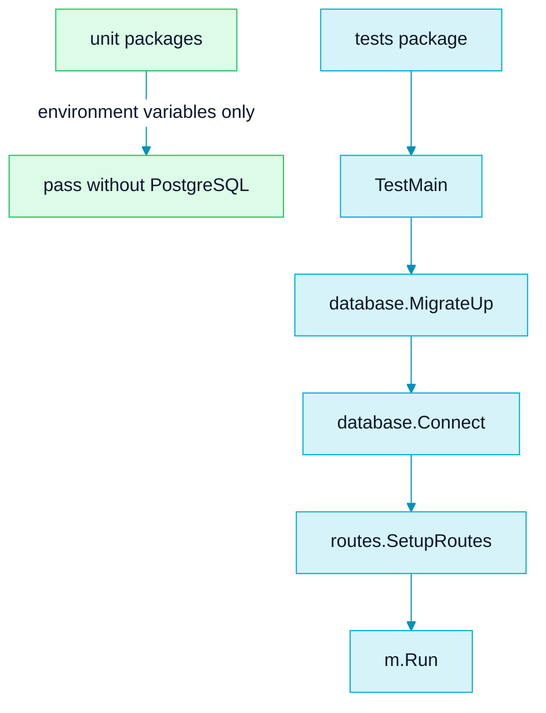
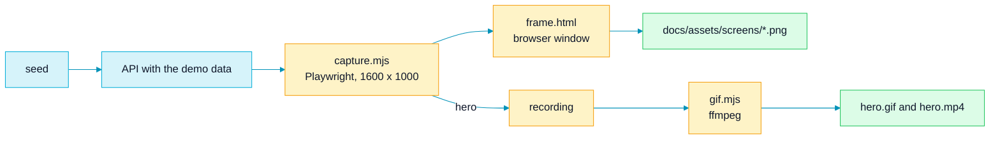

<picture>
  <source media="(prefers-color-scheme: dark)" srcset="assets/brand/header-strip-dark.svg">
  
</picture>

# Testing

Most of the suite needs nothing but Go. One package talks to a real PostgreSQL, and a separate pipeline photographs the finished product.

All commands run from the repository root.

## Quick path

```bash
docker compose -f docker-compose-test.yml up --abort-on-container-exit --exit-code-from test
docker compose -f docker-compose-test.yml down -v
```

That is the whole suite, with its own throwaway PostgreSQL. It needs no `.env` and publishes no ports.

## Packages



| Package | Test files | Needs a database | Covers |
|---|---|---|---|
| `cmd` | `main_test.go`, `seed_test.go` | No | The startup validation table (secret length, sslmode, `DATABASE_URL`) and the seed guards: environment allowlist, password, local hosts, host override parameters |
| `controllers` | `errors_test.go` | No | The typed error to status mapping, the 413 handling, and that internal details stay out of responses |
| `database` | `db_test.go` | No | The sslmode default and allowlist, DSN and URL escaping, IPv6 hosts and `DATABASE_URL` validation |
| `middleware` | `limit_test.go` | No | `LimitBody` |
| `routes` | `routes_test.go` | No | The Swagger UI and `doc.json` are served, and an oversized body gives 413 |
| `services` | `demo_seed_test.go` | No | The demo reference date parsing |
| `utils` | `jwt_test.go`, `bcrypt_test.go` | No | The secret is read at call time, secret validation, rejection of a wrong secret, and a dummy bcrypt hash that is valid at the default cost |
| `validators` | `auth_test.go` | No | The password length rules, in characters and in bytes |
| `tests` | `auth_test.go`, `task_test.go`, `demo_seed_test.go`, `utils_test.go` | Yes | End to end through the router: register, login, task CRUD, the creator versus assignee rules, and the demo seed against a real database |

Without any database variables every package passes except `tests`, which stops in `TestMain` with `Failed to apply migrations: database connection variables are not set`. The `tests` package also needs `JWT_SECRET`: any non-empty value works for the tests, and the compose file uses one of 32 bytes or more.

## The compose test stack

```bash
docker compose -f docker-compose-test.yml up --abort-on-container-exit --exit-code-from test
docker compose -f docker-compose-test.yml down -v
```

- PostgreSQL 16 runs on `tmpfs` with throwaway credentials (user `test`, database `taskmanager_test`).
- The `test` service runs `golang:1.25.14-alpine` with the repository mounted at `/app` and executes `go test ./... -count=1 -v`.
- It sets `MIGRATIONS_PATH=file:///app/database/migrations` and a test-only `JWT_SECRET`.
- Go modules are downloaded again on every run, because the stack keeps no module cache volume.
- Always finish with `down -v` to remove the containers and the network.

## Inline, with a throwaway PostgreSQL

Use this when Go is installed on your machine. Port 55432 avoids the 5432 used by the development database.

```bash
docker run -d --rm --name tm-test-db -e POSTGRES_DB=taskmanager_test -e POSTGRES_USER=test -e POSTGRES_PASSWORD=test -p 127.0.0.1:55432:5432 postgres:16-alpine
DB_HOST=localhost DB_PORT=55432 DB_USER=test DB_PASSWORD=test DB_NAME=taskmanager_test JWT_SECRET=test-only-jwt-secret-at-least-32-bytes-long go test ./... -count=1
docker stop tm-test-db
```

- Wait until `docker exec tm-test-db pg_isready -U test -d taskmanager_test` succeeds before you run the tests.
- `--rm` plus `docker stop` removes the container and its data.
- No `.env` is needed: tests do not call `godotenv.Load()`.
- To run one test, replace `./...` with a package and a filter, for example `./tests/ -run TestUpdateTaskAsCreator -v`.

## Isolation

- Tests never assume an empty database. `newTestUser` registers a user with a unique email (`<prefix>-<uuid>@example.com`), signs in through the API and returns the token. Every test gets a fresh user, so tasks never collide and the suite can run repeatedly against a persistent database.
- The suite does not delete data, so rows accumulate on a persistent database. The compose stack avoids that with `tmpfs` and `down -v`.
- The demo seed tests use their own namespace and unique emails, so they never touch the real demo rows.
- Test users share the password `test12345`, which is not a secret.

`tests/utils_test.go` `TestMain` first sets `MIGRATIONS_PATH` to `file://../database/migrations` when it is empty, because Go runs tests from the package directory and the application default would not resolve. Then it runs `database.MigrateUp()`, `database.Connect()` and `routes.SetupRoutes()`, and finally `m.Run()`. Any failure ends the run. The compose stack sets an absolute path, so the first step does nothing there.

## Conventions for new tests

- Use table-driven tests with `t.Run` where the cases are data, as in `cmd/main_test.go` and `database/db_test.go`.
- Set the environment with `t.Setenv`, never `os.Setenv`, so values are restored.
- The unit packages assert with `testify/assert`. The integration package uses plain `testing` helpers and `assert` for status checks.
- Name a test after the behaviour (`TestUpdateTaskAsNonCreator`), not the function.
- State the failure a test guards against.

## The capture pipeline

The screenshots and the hero animation in the README are produced by a script, not by hand. `e2e/showcase` drives the Swagger UI of a running API with Playwright, so the pictures always show the API as it is, framed in a browser window painted with the project palette.



It seeds the demo, takes four stills (the Swagger overview, `POST /tasks` answering 201, `GET /tasks?priority=high` and the 403 an assignee gets when editing), records the hero flow and converts it to a GIF and an MP4. Every shot asserts that the demo data is on screen, the writes clean up after themselves, and a bearer token never reaches an image.

The requirements, every variable, what each shot proves and how the cleanup works are in the [capture pipeline README](../e2e/showcase/README.md). Its `npm test` runs `redact.test.mjs`, which checks that a token and the demo password are masked in everything the script prints.

---

[Back to the README](../README.md) · Previous: [Environment](ENVIRONMENT.md) · Next: [CI](CI.md)
