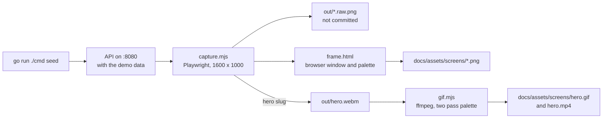

# Captures

The screenshots and the animation of the project are produced by a script, not by hand. `capture.mjs` drives the Swagger UI of a running API with a real browser, so the pictures always show the API as it is, with the same data, the same window size and the same frame. `gif.mjs` turns the recorded flow into a GIF and an MP4.



## Requirements

- A running API with the demo data. Apply the seed with the same environment the API uses, plus the demo password and `APP_ENV`: `APP_ENV=development DEMO_PASSWORD=<password> go run ./cmd seed`. The seed only runs when `APP_ENV` is `development`, `dev`, `local` or `test` (any case). An unset or any other value, production included, is refused. It replaces the demo users' tasks with the same set every time, and it aborts without touching anything when a user already holds a demo email under a different id. It prints the two demo emails.
- The seed logs its target (the host and the database name, never a credential) before it connects, and refuses a host that is not local. Local means `localhost`, `127.0.0.1`, `::1`, `db` (the compose service name) or `host.docker.internal`. The host comes from `DATABASE_URL` when it is set, otherwise from `DB_HOST`. To seed any other host on purpose, set `DEMO_SEED_ALLOW_REMOTE=1` on the seed command.
- The due dates are measured from a fixed reference date, `2026-11-02`, so the data is the same on every run. Set `DEMO_REFERENCE=YYYY-MM-DD` on the seed command to measure from another day, for example when the dates have gone stale. A value that is not a valid date is rejected before the database is opened.
- Node 22. From this folder: `npm install` and `npx playwright install chromium`.
- ffmpeg for the GIF and the MP4. Set `FFMPEG` to the executable when it is installed but not on the PATH.

## Running it

From `e2e/showcase/`, with the same password the demo was seeded with:

In bash:

```bash
export DEMO_CREATOR_EMAIL=<creator email printed by the seed>
export DEMO_ASSIGNEE_EMAIL=<assignee email printed by the seed>
export DEMO_PASSWORD=<password>
node capture.mjs
node capture.mjs hero
node gif.mjs
```

In PowerShell:

```powershell
$env:DEMO_CREATOR_EMAIL = "<creator email printed by the seed>"
$env:DEMO_ASSIGNEE_EMAIL = "<assignee email printed by the seed>"
$env:DEMO_PASSWORD = "<password>"
node capture.mjs
node capture.mjs hero
node gif.mjs
```

The seed command takes the same form in PowerShell: `$env:APP_ENV = "development"; $env:DEMO_PASSWORD = "<password>"; go run ./cmd seed`.

`node capture.mjs` takes every still, `node capture.mjs hero` records the flow and `node gif.mjs` converts it. `npm run showcase` runs the three in order. Seed again before a run if anybody has used the demo users since.

| Variable | Default | Meaning |
|---|---|---|
| `APP_ENV` | None, required by the seed | Must be `development`, `dev`, `local` or `test` for `go run ./cmd seed` to run |
| `DEMO_REFERENCE` | `2026-11-02` | Optional, read by the seed. A `YYYY-MM-DD` date the demo due dates are measured from |
| `DEMO_SEED_ALLOW_REMOTE` | unset | Read by the seed. Set to `1` to let it run against a database host that is not local |
| `BASE_URL` | `http://localhost:8080` | The API whose Swagger UI is captured. It may carry a path prefix, which is kept in the Swagger URL and in the address shown in the browser frame. A value that is not an http or https URL, or that holds credentials, a query or a fragment, ends in a `FAIL` line |
| `SHOWCASE_FETCH_TIMEOUT_MS` | `15000` | How long one API call may take before the run fails it |
| `DEMO_CREATOR_EMAIL` | None, required | The demo user who owns the tasks |
| `DEMO_ASSIGNEE_EMAIL` | None, required | The demo user the forbidden shot signs in as |
| `DEMO_PASSWORD` | None, required | The password the demo was seeded with. It is never written in the repository |
| `SHOWCASE_OUT` | `docs/assets/screens` | Where the framed shots and the animation are written |
| `SHOWCASE_FRAME_SCALE` | `1.25` | The pixel density of the framed shots |
| `SHOWCASE_DEBUG` | unset | Prints the full error of a failed shot, with its stack. Tokens and the demo password are masked in everything the script prints |
| `SLUGS` | Every still | A comma separated list of slugs to capture. A slug may also be passed as an argument |
| `FFMPEG` | `ffmpeg` | The ffmpeg executable |

The script prints `OK` or `FAIL` for each shot and exits non-zero when any failed.

## The shots

| Slug | Shows | Output |
|---|---|---|
| `overview` | The Swagger page with the auth, healthcheck and tasks groups open | `overview.png` |
| `create-task` | `POST /tasks` executed with the creator's token, answering 201 | `create-task.png` |
| `filter-high` | `GET /tasks?priority=high`, answering 200 with the seeded high priority tasks | `filter-high.png` |
| `forbidden` | The assignee trying `PUT /tasks/{id}` on the creator's task, answering 403 | `forbidden.png` |
| `hero` | Login, Authorize, create a task, then the filtered list | `hero.gif`, `hero.mp4` |

Every still also leaves its unframed screenshot in `out/<slug>.raw.png`, which is not committed.

## What each shot proves and keeps clean

- Every shot asserts that the demo data is on screen: the filtered list must contain a known seeded title, the 201 body must contain the title that was sent, and the 403 body must carry the API's message.
- Writes are limited to two flows. `create-task` and the hero each create one task and delete it through the API when they finish, even when they fail. The cleanup checks every `DELETE` and lists the tasks again, and a title that is still there fails the run. A cleanup failure is reported on its own `FAIL cleanup` line, never hides the error of the shot, and makes the exit code non-zero.
- Before it purges or creates anything, the run checks that both demo users log in and that the creator owns the seeded demo tasks. Otherwise it fails with a message to run the seed, so the purge only ever runs against the seeded demo account.
- The run removes both created titles before it starts, and again on SIGINT, SIGTERM or SIGHUP, so an interrupted run leaves no task behind. The signal handler only records the interrupt and stops the calls in flight. The run launches no further shot, runs one cleanup (never two at once), and exits with 130 for SIGINT, 143 for SIGTERM and 129 for SIGHUP. A second signal exits at once. A `DELETE` that answers 404 counts as already gone, and the list is still read again afterwards.
- On Windows, Node does not deliver SIGTERM, and closing the console window may end the process without running the cleanup. The purge at the start of the next run removes whatever was left, which is why it runs every time.
- The forbidden request is rejected by the API and changes nothing. The shot records its target task first, re-reads it afterwards, and restores it and fails loudly if it changed. The restore is a `PUT`, which changes the task's `updated_at`, so the shot compares the watched fields (title, description, due date, priority and status) and never the timestamps. No dialog is ever confirmed.
- A bearer token never reaches an image. The Authorize field shows dots, every `pre` block that would print a token (the curl command, the login response) is rewritten to its first characters before it is painted, and the page is checked after every step that renders a token. The check covers the visible text, every `pre` block and the value of every `input` and `textarea`. The Authorize field holds the token as its raw value while it renders as dots, so a masked field is checked by its rendering (the computed `-webkit-text-security` must be `disc`) and not by its raw value.
- The hero shows dots where the password goes in the login body. The request that leaves the browser carries the real password, substituted in the network layer, so the password is never on screen.
- The window is 1600 by 1000. A shot whose exchange is taller grows the window to fit it, so no response is cut. Stills are taken at twice the pixel density.
- The hero is recorded in the full Chromium build (`channel: 'chromium'`) at a pixel density of 1, because the default headless shell rasterizes in software. The GIF is 20 fps at 1100 pixels wide, under 8 MB, and the MP4 is 25 fps.

## Checks

`npm test` runs `redact.test.mjs`, which shows that `redact` masks a JWT and the demo password in everything the script prints.

`node capture.mjs hero` deletes the previous `out/hero.webm` and `out/hero.json` first, so a failed recording can never be converted and published as if it were new. `gif.mjs` checks that the cut points are finite, that the start is 0 or more and that the end is after the start, and it publishes the GIF and the MP4 as a pair: both are copied to temporary names and then renamed, and a failure leaves the published pair as it was.

## Maintenance

- Rerun the commands after a change to the API surface or to the Swagger annotations, and commit the images with the change.
- A new shot is one more entry in `SHOTS` in `capture.mjs`: a slug, a function that brings a fresh page to the state to photograph, and a `cleanup` when it writes.
- The frame is `frame.html`: the window, the address bar and the background are plain CSS in the project palette.
- The GIF has a budget of 8 MB. `gif.mjs` encodes the GIF and the MP4 into `out/` and copies them into `docs/assets/screens/` (or `SHOWCASE_OUT`) only when the GIF is under the budget, so a run that is over leaves the published animation as it was. `WIDTH` and `FPS` at its top, or a shorter flow, are the levers.
